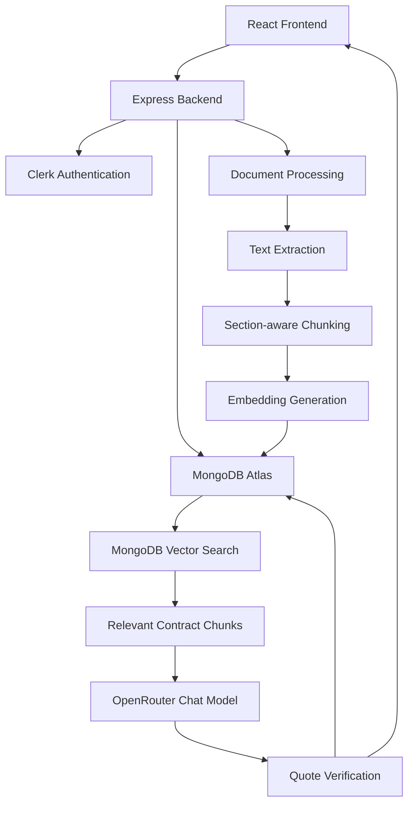

# Contract Review Assistant

An AI-powered contract review application that allows authenticated users to upload contracts and automatically review them against a predefined legal checklist.

The application extracts contract content, generates embeddings, retrieves relevant clauses using MongoDB Vector Search, and uses an AI model to produce structured findings with exact supporting quotes.

## 1. Features

- User authentication using Clerk.
- Secure, user-specific contract management.
- Upload PDF, DOCX, and TXT contracts (maximum 20 MB).
- Automatic text extraction and document chunking.
- Vector embeddings and semantic search.
- AI-powered contract review against 8 checklist items.
- Found, Not Found, and Unclear statuses.
- Plain-English summaries with exact supporting clauses.
- Backend verification of AI-generated quotes.
- Follow-up questions through a contract-based chat.
- Persistent contract reviews and chat history.

## 2. Tech Stack

| Technology | Purpose | Why I chose it |
|---|---|---|
| React | Frontend | Component-based UI and reusable components |
| Node.js | Backend runtime | JavaScript across frontend and backend |
| Express.js | Backend API | Simple REST API development |
| MongoDB Atlas | Database | Flexible document storage |
| MongoDB Vector Search | Semantic retrieval | Search relevant contract chunks using embeddings |
| Mongoose | ODM | Schema validation and database operations |
| Clerk | Authentication | Secure signup, signin, and session management |
| OpenRouter | AI API | Access to embedding and chat models |
| PDF/DOCX parsers | Text extraction | Extract text from uploaded documents |

## 3. Architecture



### Main workflow

1. The user signs in through Clerk.
2. The frontend sends the Clerk session token with API requests.
3. The backend verifies the token before processing protected requests.
4. The user uploads a contract.
5. The backend extracts text from the document.
6. Extracted text is divided into smaller chunks while preserving section and page metadata.
7. Embeddings are generated and stored in MongoDB.
8. MongoDB Vector Search retrieves relevant chunks for each checklist item.
9. The AI model analyzes the retrieved evidence.
10. The backend verifies generated quotes against the original extracted contract text.
11. Verified findings are saved and returned to the frontend.

## 4. Setup Instructions

### Prerequisites

- Node.js installed
- MongoDB Atlas account
- Clerk account
- OpenRouter account
- Git

### Step 1: Clone the repository

```bash
git clone YOUR_GITHUB_REPOSITORY_URL
cd contract-review-assistant
```

### Step 2: Install dependencies

Install frontend dependencies:

```bash
cd client
npm install
```

Install backend dependencies:

```bash
cd ../server
npm install
```

### Step 3: Configure Clerk

1. Visit https://dashboard.clerk.com/
2. Create a Clerk account.
3. Create a new application.
4. Enable the authentication methods you want to support, such as email and password.
5. Open the API Keys section.
6. Copy the Publishable Key and Secret Key.

Where the keys go:

- Frontend: Clerk Publishable Key.
- Backend: Clerk Secret Key.

Never expose the Clerk Secret Key in frontend code.

### Step 4: Configure OpenRouter

1. Visit https://openrouter.ai/
2. Create an account.
3. Open the API Keys section.
4. Generate a new API key.
5. Add the key to the backend environment file.

OpenRouter provides access to embedding and chat models. Free models may have request and daily usage limits.

### Step 5: Configure MongoDB Atlas

1. Create a MongoDB Atlas cluster.
2. Create a database named `contract_review`.
3. Configure database access and network access.
4. Copy the MongoDB connection string.
5. Add it to the backend `.env` file.

Create a Vector Search index on the `chunks` collection.

The index should include:

- Vector field: `embedding`
- Dimensions: `2048`
- Similarity: `cosine`
- Filter fields: `userId` and `contractId`

Use the same embedding model and dimensions for all vectors stored in this index.

### Step 6: Environment variables

Copy `server/.env.example` to `server/.env` and `client/.env.example` to
`client/.env`, then fill in the credentials. The root `.env.example` lists
both sets of variables for reference.

Backend `.env`:

```env
PORT=5000
CLIENT_URL=http://localhost:5173

MONGODB_URI=your_mongodb_connection_string

CLERK_SECRET_KEY=your_clerk_secret_key

OPENROUTER_API_KEY=your_openrouter_api_key

OPENROUTER_EMBEDDING_MODEL=nvidia/nemotron-3.5-embed-1b:free
EMBEDDING_DIMENSIONS=2048

OPENROUTER_CHAT_MODELS=nvidia/nemotron-3-ultra-550b-a55b:free,google/gemma-4-31b-it:free
```

Frontend `.env`:

```env
VITE_CLERK_PUBLISHABLE_KEY=your_clerk_publishable_key
VITE_API_URL=http://localhost:5000
```

**Important:** Environment variable names must match those used in the application code. Never commit `.env` files.

Do not commit either `.env` file. The `.env.example` files contain placeholders
and can be committed safely.

### Step 7: Run the application

Start the backend:

```bash
cd server
npm run dev
```

Start the frontend in another terminal:

```bash
cd client
npm run dev
```

Open the frontend URL displayed in your terminal.

## 5. Contract Processing and Chunking

The application uses a document-processing pipeline:

1. Extract text from PDF, DOCX, or TXT files.
2. Preserve page numbers and section information wherever available.
3. Split the extracted content into smaller chunks.
4. Generate embeddings for the chunks.
5. Store chunks and embeddings in MongoDB.

### Chunking strategy

The current chunking implementation uses:

| Parameter | Value |
|---|---:|
| Maximum chunk size | 2500 characters |
| Target chunk size | 1500 characters |
| Overlap | 200 characters |

The chunking logic attempts to preserve paragraph and section boundaries.

Each chunk stores:

- userId
- contractId
- chunkIndex
- text
- pageNumber
- section metadata
- embedding
- embeddingModel

This metadata helps identify where retrieved evidence came from.

## 6. Checklist and Retrieval Strategy

The application reviews contracts against eight predefined checklist items.

Each checklist item has its own search query. These queries are converted into embeddings and used to retrieve relevant chunks through MongoDB Vector Search.

| Checklist item | Retrieval focus | Why it matters |
|---|---|---|
| Parties | Agreement parties, service provider, client | Identifies the contracting entities |
| Start date and term | Effective date, commencement, duration, expiry | Identifies when the agreement begins and ends |
| Payment terms | Fees, invoices, due dates, taxes, interest | Identifies financial obligations |
| Termination | Termination rights, notice period, breach, cure period | Identifies how the agreement can end |
| Limitation of liability | Liability cap, exclusions, damages | Identifies financial risk limitations |
| Confidentiality | Confidential information, disclosure restrictions, survival period | Identifies confidentiality obligations |
| Governing law | Applicable law, jurisdiction, courts | Identifies the applicable legal framework |
| Auto-renewal | Automatic renewal, renewal period, non-renewal notice | Identifies renewal conditions |

For each checklist item:

1. Generate an embedding for its search query.
2. Retrieve the most relevant contract chunks.
3. Pass the evidence to the AI model.
4. Generate a structured finding.
5. Verify the generated quote against the original contract text.

The system does not assume that a standard legal clause exists. If the evidence does not establish that a clause is present, it should return `not_found` or `unclear` as appropriate.

## 7. Quote Verification

AI-generated findings must be supported by the uploaded contract.

The backend verifies each generated quote against the original extracted contract text.

The verification process:

1. Identify the evidence chunk associated with the finding.
2. Check that the referenced chunk belongs to the correct contract.
3. Compare the generated quote against the source text.
4. Normalize whitespace for comparison without changing the actual displayed quote.
5. Verify that the quote genuinely exists in the source evidence.

If the generated quote cannot be verified, the finding is marked as `unclear` rather than being presented as a confirmed clause.

This helps prevent fabricated or unsupported legal findings.

## 8. User Authentication and Data Isolation

Clerk handles user authentication.

The backend verifies the Clerk session token on protected API requests.

The application does not trust a user ID supplied by the frontend.

Instead, the authenticated user identity is obtained from the verified session.

Every contract-related database operation is scoped using the authenticated user ID.

For example:

```javascript
const contract = await Contract.findOne({
  _id: contractId,
  userId: req.userId
});
```

The same user and contract restrictions are applied to:

- Contract listing
- Contract retrieval
- Contract deletion
- Review retrieval
- Chat history
- Vector Search filters

Vector Search uses both `userId` and `contractId` filters to prevent retrieval of another user's contract chunks.

This ensures that users cannot access another user's contracts simply by changing a contract ID in an API request.

## 9. Chat and Follow-up Questions

Users can ask questions about their uploaded contracts.

The chat pipeline:

1. Receive the user's question.
2. Generate a query embedding.
3. Retrieve relevant contract chunks.
4. Pass the retrieved evidence to the chat model.
5. Generate an answer grounded in the contract.
6. Include supporting clauses and section information.
7. Save the conversation against the corresponding contract and user.

The AI is instructed to answer only from the supplied contract evidence.

If the contract does not contain the requested information, the assistant should clearly state that it could not find the information.

## 10. Known Limitations

- OpenRouter free models have request and daily usage limits.
- Embedding and chat model availability can vary.
- Semantic retrieval quality depends on chunking, embeddings, and search queries.
- Complex tables and unusual document layouts may affect text extraction.
- Legal language may require human interpretation; the application is an assistance tool, not a substitute for legal advice.
- More advanced retrieval evaluation and automated test coverage would improve reliability.

## 11. Future Improvements

With more development time, I would improve the application by:

- Adding automated tests for authentication and user isolation.
- Improving retrieval using hybrid semantic and keyword search.
- Adding model retry, fallback, and provider monitoring.
- Improving extraction of tables, headers, and complex PDF layouts.
- Adding confidence scoring and better evidence ranking.
- Supporting larger contracts through background job processing.
- Adding Docker Compose for easier local setup.
- Adding more comprehensive evaluation datasets for review accuracy.

## 12. AI Tools Used

AI tools were used as development assistants during the implementation.

### ChatGPT

Used for:

- Understanding and planning the application architecture.
- Breaking down the assignment into implementation steps.
- Debugging backend and database issues.
- Understanding MongoDB Vector Search and RAG concepts.
- Reviewing error messages and improving implementation.
- Preparing documentation and explaining technical decisions.

### Claude

Used for:

- Debugging implementation issues.
- Analyzing code and troubleshooting errors.
- Reviewing technical approaches and suggesting improvements.

AI tools assisted development, but the application logic, integration, testing, and final implementation were reviewed and run in the project environment.

## 13. Security Notes

- Never commit `.env` files.
- Never expose Clerk Secret Keys or OpenRouter API keys.
- Verify authentication tokens on the backend.
- Scope all contract and review queries to the authenticated user.
- Validate uploaded file types and file sizes.
- Verify generated quotes before displaying findings.

## 14. Project Status

The project is developed as a full-stack Contract Review Assistant using Clerk, Express, MongoDB Atlas, MongoDB Vector Search, and OpenRouter.

The goal is to provide contract-grounded review findings with verifiable evidence and secure user-specific data access.
